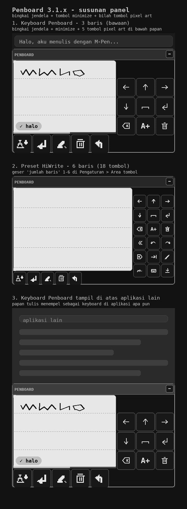

# Penboard

Papan tulis stylus bergaya **HiWrite** untuk Android, dengan tema **retro cyberpunk grayscale ePaper**. Tulis dengan Huawei M-Pen (atau stylus apa pun) di papan tulis, lalu tulisan itu berubah menjadi teks dan langsung masuk ke kolom isian aplikasi yang sedang dipakai. Bukan keyboard QWERTY: papan tulisnya lebar di kiri, tombolnya berupa **ikon** dan tersusun rapi 3 kolom di kanan.

Versi terbaru: **3.1.2** (lihat [Releases](https://github.com/retrobit-dev/RetroBit-Penboard/releases) untuk berkas APK).

## Yang baru di 3.1.2

- **Tombol bawah bawaan semuanya benar-benar bekerja.** Tombol "teks kosong" yang tidak melakukan apa-apa diganti **enter** — sekarang bawaan bilah bawah = **A+ (jadikan teks), enter, hapus goresan, bersihkan papan, batal**. Ada tesnya: tidak boleh ada tombol bawah bawaan yang aksinya kosong.
- **Papan tulis tidak lagi terpotong di layar kecil.** Bila ruang yang disediakan keyboard lebih pendek dari tinggi papan + bilah judul + tombol bawah, papan dipangkas otomatis sampai semuanya muat (hitungan di `GridMath.fitBoardHeightPx`, diuji unit). Perilakunya berlaku saat keyboard muncul dan saat ukurannya berubah, termasuk saat orientasi layar berputar.

## Yang baru di 3.1.1

- **Tombol bawah duduk rapi di dalam bingkai**, tepat di bawah area menulis (bukan lagi bilah yang melebar ke seluruh panel). Papan tulis dan tombol bawahnya sekarang satu kolom di dalam bingkai jendela.
- **Ukurannya sama persis dengan tombol samping** (tinggi papan ÷ jumlah baris grid), jadi satu baris tombol bawah terlihat sejajar dengan satu baris tombol kanan.
- Bila satu baris tidak cukup, tombolnya **mengalir ke baris berikutnya** di bawah papan tulis (hitungannya di `GridMath.columnsFor` / `GridMath.wrapRows`, diuji unit).

## Yang baru di 3.1.0

**Papan tulis sekarang berbingkai seperti jendela, dan punya tombol minimize.**

- **Bingkai jendela**: garis tepi lebih tegas, **bilah judul** di atas papan (judulnya bisa diganti, bawaan `PENBOARD`), dan **tombol minimize** di kanan bilah judul. Sekali ketuk minimize, papan langsung disembunyikan (keyboard ditutup) dan layar jadi lega; sentuh kolom isian kalau ingin memunculkannya lagi.
- **Tombol di bawah papan tulis**: tempat menaruh tombol yang bisa diatur — jumlahnya 0–8, tiap tombol bebas dipilih aksinya (dan bisa diberi label serta tahan-untuk-mengulang). Ukurannya sama dengan tombol samping dan mengalir ke baris berikutnya bila tidak muat. Bawaannya: A+ (jadikan teks), enter, hapus goresan, bersihkan papan, batal.
- **Ikonnya pixel art asli**: kanvas 12 x 12 piksel yang digambar kotak demi kotak tanpa anti-aliasing (`util/PixelArt.kt`), bukan ikon vektor yang diperkecil. Semua aksi punya ikonnya sendiri — termasuk tombol minimize.
- Preset **HiWrite** menyalakan bingkai jendela, tombol minimize, dan 5 tombol bawah sekaligus. Keduanya bisa dimatikan di kartu **Jendela papan** dan **Tombol bawah**.

## Yang baru di 3.0.9

**Papan melayang dihapus.** Papan tulis utama tetap bisa dipakai di atas aplikasi lain — sekarang lewat satu jalan saja, yaitu sebagai **keyboard**: pilih Penboard sebagai keyboard, dan panelnya menempel di bawah layar aplikasi apa pun, tanpa izin *tampil di atas aplikasi lain*, tanpa foreground service, dan tanpa notifikasi.

- Papan melayang yang lama tidak hilang fungsinya: yang dihapus hanya jendela kedua yang harus digeser-geser sendiri.
- Ikon **dua jendela** pada grid (dulu untuk menyalakan papan melayang) diganti ikon **papan tombol kecil**: sekali ketuk membuka pemilih keyboard Android, jadi Anda bisa pindah ke tulisan tangan Huawei/Celia dan kembali ke Penboard dengan cepat.
- Layanan aksesibilitas **Penboard Tulis Otomatis** tetap ada sebagai cadangan (kartu **Keyboard Penboard** → Aktifkan Tulis Otomatis) untuk saat keyboard yang aktif bukan Penboard.
- Pengaturan **"Sembunyikan keyboard sistem"** ikut dihapus — dulu hanya perlu karena ada dua papan sekaligus.
- Pratinjau di halaman pengaturan tidak lagi punya bilah pegangan.

## Yang baru di 3.0.8

- **Tidak lagi ada dua keyboard.** Saat papan melayang dipakai, keyboard sistem ditutup otomatis — keyboard Penboard menutup dirinya sendiri, dan keyboard lain (mis. Huawei) ditutup lewat layanan **Penboard Tulis Otomatis**. Pengaturan baru **"Sembunyikan keyboard sistem"** di kartu Papan melayang (bawaan: nyala) bisa dimatikan bila Anda ingin keyboard tetap terbuka.
- **Geser papan melayang sudah benar arahnya**: menarik pegangan **ke atas menaikkan papan**, ke bawah menurunkan — sebelumnya terbalik karena `y` diukur dari tepi bawah layar (`Gravity.BOTTOM`).
- **Papan tidak bisa lagi nyangkut di luar layar**: posisi saat digeser dan posisi yang tersimpan dari sesi sebelumnya selalu dibatasi agar papan tetap terlihat penuh.

## Yang baru di 3.0.7

**Penting untuk perangkat Huawei/Honor tanpa Google Play services.** Mesin pengenalan Penboard (ML Kit) memang **tidak bisa berjalan tanpa Google Play services** — dan di perangkat seperti itu setiap tulisan berakhir dengan pesan "tidak terbaca" yang membingungkan (atau tidak ada pesan sama sekali). Sekarang alurnya jelas:

- **Pemeriksaan perangkat** menyebutkan keadaan Google Play services apa adanya — *tidak terpasang*, *perlu diperbarui*, *dinonaktifkan*, *tidak sah*, atau *sedang diperbarui* — bukan hanya "tidak tersedia".
- **Google Play services versi lama tidak lagi dianggap mati**: Penboard tetap mencoba mengenali, karena GMS versi lama umumnya masih bisa. Kalau ternyata memang perlu diperbarui, muncul tombol **"Perbarui Google Play services"** (membuka Play Store).
- Selalu ada tombol **"Buka keyboard tulisan tangan perangkat"** (pemilih keyboard) supaya Anda bisa berpindah ke tulisan tangan Huawei/Celia — dan papan melayang pun menawarkan itu otomatis saat mesinnya tidak ada.
- Papan tidak lagi menulis "tidak terbaca" untuk masalah mesin: kilasannya **"✗ mesin tidak ada"**, disertai penyebab + saran langkah yang bisa dilakukan.
- Bahasa yang belum didukung mesin diberi pesan sendiri ("pilih bahasa lain di kartu Pengenalan tulisan"), bukan disamakan dengan tulisan yang tidak terbaca.
- Panggilan ke ML Kit dibungkus pengaman: perangkat tanpa GMS tidak lagi bisa membuat aplikasi berhenti atau menggantung.

## Yang baru di 3.0.6

- **Tulisan dikirim ke mesin dalam beberapa versi ukuran.** Sebelumnya tinta selalu diperkecil mengikuti jarak baris panduan, sehingga tulisan kecil bisa jadi terlalu mungil untuk dikenali. Sekarang tinta yang sama disiapkan dalam beberapa versi (normalisasi baris, lalu dipaskan ke kotak tetap tinggi 160 dan 320) dan dicoba berurutan **sampai ada yang terbaca** — jadi ukuran tulisan tidak lagi menentukan berhasil/tidaknya.
- **Mesin diberi keterangan tambahan** (`RecognitionContext`): **ukuran bidang tulisan** (membantu membedakan huruf kecil dan huruf besar) dan **beberapa huruf sebelum kursor** — dipakai untuk memilih kata yang paling cocok dengan kalimat yang sedang ditulis.
- **Diagnostik baru**: kartu pemeriksaan menampilkan **jawaban terakhir mesin** (kandidat teks), dan ada tombol **"Salin laporan mesin"** yang menyalin ringkasan (versi, mesin tersedia/tidak, bahasa, status model, jumlah goresan/titik tinta, kandidat terakhir, pesan terakhir) untuk dilaporkan bila masih gagal.
- Pesan gagal baca kini menyebutkan **apa yang sebenarnya dibaca mesin** bila ada kandidat.

## Yang baru di 3.0.5

- **"✗ tidak terbaca" diperbaiki.** Selama ini Penboard mengirim tulisan ke mesin pengenalan tanpa memastikan **model bahasanya sudah terunduh**; ML Kit menolak permintaan itu, dan Penboard salah menerjemahkannya menjadi "tidak terbaca" — padahal masalahnya bukan tulisan Anda.
  - Sekarang Penboard **memeriksa dulu** status model: kalau sudah ada → langsung dikenali; kalau belum → **diunduh otomatis sekali** (dengan pemberitahuan "±20 MB, tunggu sebentar"), lalu tulisan yang sama langsung dikenali tanpa perlu ditulis ulang.
  - Bila internet tidak ada, muncul pesan yang benar: **"✗ model bahasa belum ada"** + tawaran pindah ke keyboard tulisan tangan perangkat — bukan lagi "tidak terbaca".
- **Alasan teknis ikut ditampilkan** saat pengenalan gagal, dan **kartu pemeriksaan** kini menampilkan status model bahasa (siap / belum diunduh) serta pesan terakhir dari mesin pengenalan — memudahkan menelusuri kalau ada masalah.
- `util/LanguageTags.kt`: mesin pengenalan menerima tag bahasa BCP-47 dengan atau tanpa wilayah (mis. `id-ID` dicoba, lalu `id` — nama model bahasa Indonesia di ML Kit), diuji unit.

## Yang baru di 3.0.4

- **Hasil tulisan langsung masuk ke kolom isian, tidak lagi sekadar tersalin.** Papan melayang bisa menulis lewat dua jalan:
  1. **keyboard Penboard** dipilih sebagai keyboard aktif (cara paling tepat), atau
  2. layanan aksesibilitas **"Penboard Tulis Otomatis"** — dipakai bila Anda memakai keyboard lain (mis. keyboard Huawei) atau tidak memakai keyboard sama sekali. Penboard menyisipkan teks pada posisi kursor tanpa menghapus isi kolom, dan kalau kolomnya tidak mendukung, memakai tempel dengan isi papan klip dikembalikan seperti semula.
- Kartu **Papan melayang** sekarang menampilkan status "Penboard Tulis Otomatis" + tombol untuk membukanya di Pengaturan > Aksesibilitas.
- Tombol kursor, hapus, dan papan klip juga bekerja lewat layanan itu, jadi papan melayang bisa dipakai sendiri tanpa keyboard Penboard.
- Pesan saat teks hanya bisa disalin sekarang menjelaskan **apa yang harus dinyalakan**.

## Yang baru di 3.0.3

- **Lencana hasil di papan lebih mudah dibaca**: teks kilasan ("✓ teks" / "✗ tidak terbaca") sekarang otomatis memilih tinta gelap atau putih sesuai kecerahan warna aksen — pada tema retro yang beraksen terang, teksnya jadi gelap dan tidak lagi tenggelam. (`util/ColorMath.kt`, diuji unit.)
- **Pratinjau susunan** ada di `docs/preview.png` (lihat di bawah) supaya mudah dibandingkan sebelum menyetel.

## Yang baru di 3.0.2

- **Preset HiWrite satu ketukan** (kartu "Mulai cepat" di halaman utama): langsung menyetel papan tinggi, 6 baris tombol berikon, tema retro grayscale ePaper, dan input otomatis 2 detik. Bahasa tulisan dan tombol samping pena tidak diubah.

## Yang baru di 3.0.1

- **Area tombol bertambah sampai 6 baris** (3 kolom tetap) — jadi sampai **18 tombol** yang semuanya bisa diatur, bukan lagi 12.
- Bawaan baris 5 dan 6 kini terisi: tab, hapus huruf di depan kursor, ganti warna pena, tulisan tangan perangkat (Huawei/Celia), pemilih keyboard, dan sembunyikan keyboard — siap dipakai atau tinggal diganti. (Sejak 3.0.9 tidak ada lagi tombol papan melayang.)
- Ukuran tombol tetap otomatis: makin banyak baris, makin kecil tombolnya, tetapi papan tulis tidak pernah kalah lebar (maksimal 34% layar untuk kolom tombol).

## Yang baru di 3.0.0

- **Tombol penempatan kursor**: ← → ↑ ↓ plus ke awal/akhir baris, digambar sebagai ikon panah (bisa ditahan untuk menggeser cepat).
- **Tombol keyboard konvensional**: spasi, enter, hapus (⌫, tahan untuk mengulang), hapus satu kata, hapus huruf di depan kursor, dan tab — semuanya berikon.
- **Tombol papan klip**: pilih semua, potong, salin, tempel.
- **Semua tombol memakai ikon**, bukan tulisan, sehingga ukurannya kecil dan seragam.
- **Jumlah baris area tombol bisa diatur**: 1 baris, 2 baris, sampai 6 baris (3 kolom tetap) — jadi sampai 18 tombol, dan jumlah tombol yang tampil juga bisa diatur (1–18).
- **Tema retro cyberpunk grayscale ePaper**: papan warna kertas, panel hitam bertekstur garis pindaian, garis panduan titik-titik, tombol monokrom, dan huruf mesin tik (monospace). Satu tombol untuk kembali ke tema ini kapan saja.
- **Papan tulis overlay dengan transparansi yang bisa diatur** (panel, papan, dan tombol masing-masing 0–100%).

## Cara pakai singkat

1. Pasang APK, buka Penboard, ikuti **panduan 3 langkah** di halaman utama.
2. Tulis satu kata dengan M-Pen. Begitu tidak ada goresan baru selama **2 detik**, tulisan otomatis menjadi teks + satu spasi, jadi kata berikutnya tinggal ditulis.
3. Butuh memindahkan kursor atau menambah spasi/enter? Pakai tombol ikon di kanan papan.
4. Ingin memaksa jadi teks sekarang? Ketuk tombol ikon **"A + percikan"** (Teks), atau tekan **tombol samping M-Pen**.
5. Mau layar lega? Ketuk tombol **minimize** (garis mendatar) di kanan bilah judul jendela — papan langsung disembunyikan.
6. Ingin menulis di atas aplikasi lain? Penboard sudah keyboard: panelnya menempel di atas aplikasi apa pun yang sedang dipakai. Mau pindah ke tulisan tangan Huawei dan kembali? Ketuk tombol ikon **papan tombol kecil** (pemilih keyboard).

## Susunan papan



```
+----------------------------------------------+----------------+
|  PENBOARD                            [ -- ]  |  bilah judul   |
+----------------------------------------------+----------------+
|                                              |   [<-] [^] [->] |  baris 1
|            PAPAN TULIS (kiri)                |   [v] [spasi] [!]|  baris 2
|      dari tepi kiri sampai ke tombol         |   [x] [A+] [tmr] |  baris 3
|  [A+][teks][hapus][bersih][batal] [batal]    |   [x2][u] [r]    |  baris 4
|  ^ tombol bawah, ukurannya sama dengan       |   [x>][tab][wrn] |  baris 5
|    tombol samping, tepat di bawah papan      |   [tw][pkb][tut] |  baris 6
+----------------------------------------------+----------------+
```

Bilah judul berisi judul jendela + tombol minimize. **Tombol bawah** berada di dalam
bingkai yang sama, tepat di bawah area menulis, dengan ukuran sama seperti tombol samping;
isinya bebas diatur (lihat **Pengaturan yang tersedia**).

Tinggi papan menyesuaikan ruang yang disediakan keyboard: kalau layar tidak cukup untuk
bingkai + bilah judul + tombol bawah, papan dipangkas otomatis (setidaknya 120 dp) supaya
tidak ada bagian yang terpotong.

- **Papan tulis** memakai lebar sebanyak mungkin di kiri (sampai menyentuh tombol).
- **Area tombol**: 3 kolom tetap, jumlah baris 1–6 (diatur pengguna), sampai 18 tombol.
- Setiap tombol bebas dipilih aksinya dan bisa diberi label sendiri.

## Daftar tombol (ikon)

| Ikon | Aksi |
| --- | --- |
| panah ← → ↑ ↓ | geser kursor kiri/kanan/atas/bawah |
| panah + garis | kursor ke awal baris / ke akhir baris |
| ␣ | spasi |
| ↵ | enter / baris baru |
| ⌫ | hapus satu huruf (tahan = mengulang) |
| huruf dicoret | hapus satu kata |
| ⌫ terbalik | hapus huruf di depan kursor |
| tab | tab (kolom berikutnya) |
| bingkai putus-putus | pilih semua teks |
| gunting | potong | 
| dua lembar | salin |
| papan klip | tempel |
| pena | ganti warna pena |
| A + percikan | ubah tulisan menjadi teks |
| tong sampah | bersihkan papan |
| penghapus | hapus goresan terakhir |
| panah melengkung | batal (undo) / ulangi (redo) |
| coretan tangan | pindah ke tulisan tangan perangkat (Huawei/Celia) |
| papan tombol kecil | buka pemilih keyboard (mis. pindah ke tulisan tangan Huawei) |
| panah bawah | sembunyikan keyboard |
| garis mendatar (pixel art) | minimize: sembunyikan papan (di bilah judul jendela) |

Tombol **grid** memakai ikon vektor monokrom; tombol **bilah bawah** memakai ikon
**pixel art** 12 x 12 dari `util/PixelArt.kt` (setiap aksi punya polanya sendiri).

## Pengaturan yang tersedia

| Bagian | Isi |
| --- | --- |
| Papan tulis | tinggi papan, jarak garis panduan, tebal pena, 1–6 warna pena, garis panduan, ketebalan ikut tekanan stylus, izinkan jari, getaran |
| Area tombol | **jumlah baris 1–6**, jumlah tombol tampil 1–18, fungsi + label + teks tiap tombol, ulangi saat ditahan, kembali ke bawaan |
| Pengenalan | input otomatis on/off, jeda 0,5–5 detik (bawaan 2 detik), spasi otomatis, kosongkan papan setelah jadi teks, bahasa tulisan, unduh model bahasa |
| Tampilan | **tema retro cyberpunk grayscale ePaper** (satu tombol), garis pindaian, transparansi panel/papan/tombol 0–100%, warna panel/papan/garis/tombol/teks tombol/aksen, lengkung sudut |
| Tombol samping pena | aksi klik dan aksi kedua, dari 7 pilihan |
| Jendela papan | bingkai jendela on/off, tombol minimize on/off, judul jendela (bawaan `PENBOARD`) |
| Tombol bawah | tampil/tidak, **jumlah 0–8**, aksi + label + tahan-untuk-mengulang tiap tombol (ukuran = tombol samping, di bawah area menulis), kembali ke bawaan (A+, enter, hapus goresan, bersihkan papan, batal) |

Tombol panah kursor, papan klip, tab, dan hapus di depan kursor bekerja saat keyboard Penboard aktif — semuanya memerlukan kolom isian.

## Mesin pengenalan

Pengenalan memakai **ML Kit Digital Ink Recognition** (Google) yang berjalan **di dalam ponsel dan luring** setelah model bahasanya terunduh. Bawaan: bahasa Indonesia (`id-ID`, sekitar 20 MB). Tersedia juga English US/UK, Melayu, Jawa, Sunda, 中文, 日本語, 한국어, العربية, Русский, हिन्दी, ไทย, Tiếng Việt.

Umpan balik saat menulis:

- Garis **hitung mundur** di papan menunjukkan kapan input otomatis akan berjalan; hitungan berhenti begitu pena kembali menyentuh papan (atau bisa dimatikan).
- Setelah teks terkirim, muncul **kilasan tanda centang + teks**; kalau gagal, muncul **"✗ tidak terbaca"**.
- **Tekanan M-Pen** membuat goresan lebih tebal atau tipis; **ujung penghapus stylus** menghapus goresan di sekitar sentuhan.

### Soal Huawei

Mesin tulisan tangan Huawei (Celia) **tidak bisa dipanggil oleh aplikasi lain** — Huawei hanya menyediakannya lewat keyboard bawaannya, dan HMS ML Kit hanya menyediakan OCR gambar (bukan tulisan tangan). Karena itu Penboard:

1. memakai tombol samping M-Pen sebagai pemicu teks sehingga tidak bentrok dengan pintasan keyboard Huawei;
2. menyediakan tombol **coretan tangan** pada grid untuk berpindah ke keyboard tulisan tangan bawaan, dan bisa kembali ke Penboard kapan saja;
3. mematikan tulisan tangan sistem pada kolom **Uji tulis** (agar goresan tidak muncul dua kali);
4. punya pilihan **pindah otomatis** ke keyboard tulisan tangan perangkat bila mesin pengenalan bawaan tidak ada (mis. perangkat Huawei tanpa Google Play services).

Semua data tetap di ponsel. Tidak ada tulisan yang dikirim ke server mana pun; hanya unduhan model bahasa yang menyentuh internet, itu pun sekali per bahasa.

## Menulis di atas aplikasi lain

Penboard adalah keyboard, jadi papan tulisnya sudah menempel di atas aplikasi apa pun yang sedang dipakai — tidak perlu izin khusus.

- **Keyboard Penboard aktif** (cara utama): tulis di papan, teks masuk ke kolom isian yang sedang fokus.
- **Keyboard lain yang aktif** (mis. keyboard Huawei): nyalakan layanan aksesibilitas **Penboard Tulis Otomatis** (kartu *Keyboard Penboard* → *Aktifkan Tulis Otomatis*). Layanan ini menuliskan hasil tulisan ke kolom isian aplikasi lain tanpa Penboard harus menjadi keyboard.
- **Belum ada keduanya**: teks disalin ke papan klip, dan pesannya menjelaskan apa yang perlu dinyalakan.

Layanan aksesibilitas hanya menulis teks; ia tidak membaca layar untuk hal lain dan tidak mengirim data ke mana pun.

## Bangun sendiri

```bash
./gradlew assembleDebug     # APK debug
./gradlew assembleRelease   # APK rilis (dipakai CI)
./gradlew test              # pengujian unit
```

Butuh JDK 17 dan Android SDK dengan platform 35. Rilis ditandatangani kunci debug kecuali berkas `keystore.properties` disediakan:

```properties
storeFile=...
storePassword=...
keyAlias=...
keyPassword=...
```

Teknologi: Kotlin 2.0, AGP 8.7, Gradle 8.11, `minSdk 26`, `targetSdk 35`, satu modul `app`, tanpa berkas tata letak XML (seluruh tampilan dibuat dari kode, termasuk ikon tombol).

## Struktur berkas

```
app/src/main/java/dev/retrobit/penboard/
├── MainActivity.kt            pengaturan + pratinjau + uji tulis
├── board/                     BoardView (kanvas stylus), Stroke
├── data/                      PenboardConfig + ConfigStore (JSON)
├── ime/                       PenboardInputService (keyboard)
├── overlay/                   PenboardTypingService (layanan aksesibilitas cadangan)
├── ink/                       InkRecognition (ML Kit), InkNormalizer, RecognitionText, RecognitionLanguages
├── ui/                        BoardPanel, KeyButton, KeyIcons, ScanlineDrawable, Ui, ColorPicker
└── util/                      BoardMath, GridMath, PixelArt, StylusCompat, SystemHandwriting, GmsStatus, LanguageTags, AccessibilityIds, TextInsert
```

## Lisensi

MIT — lihat [LICENSE](LICENSE).
